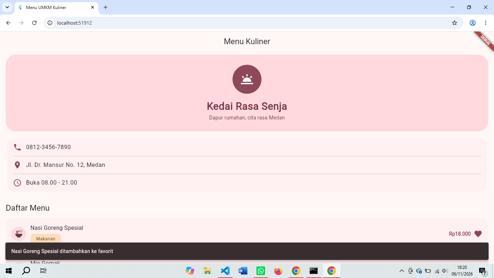

# pm-pertemuan-05-4241250005

Tugas Rutin 5 - Pemrograman Mobile: Menu UMKM Kuliner

- Nama: Nayla Anjani Nasution
- NIM: 4241250005
- Kelas: PSIK 24C

Aplikasi Flutter yang menampilkan halaman menu sebuah warung (Kedai Rasa Senja): header toko, kartu kontak, dan daftar 15 menu (5 makanan, 5 minuman, 5 kue). Setiap menu punya tombol favorit. Data warung (nama, alamat, telepon) hanya contoh.

## Cara Menjalankan

```
flutter pub get
flutter run -d chrome
flutter test
```

Proyek memakai paket `material_ui` (`import 'package:material_ui/material_ui.dart';`) sesuai materi Pertemuan 5.

## Tangkapan Layar

Menu ditambahkan ke favorit:



Menu dihapus dari favorit:


## Diagram Widget Tree

```
MaterialApp (theme, darkTheme)
└─ HalamanMenu (Stateless)
   └─ Scaffold
      ├─ AppBar
      └─ ListView
         ├─ HeaderToko (Stateless)
         ├─ KartuKontak (Stateless)
         │  └─ Card
         │     └─ ListTile x3 (telepon, alamat, jam buka)
         └─ KartuMenu x15 (Stateless)
            ├─ CircleAvatar (ikon kategori)
            ├─ Chip (kategori)
            ├─ Text (nama dan harga)
            └─ TombolFavorit (Stateful)
```

Pada contoh di slide ada 4 `KartuMenu`. Di aplikasi ini jumlahnya 15 karena setiap kategori berisi 5 menu. Strukturnya sama, hanya data di `daftarMenu` yang lebih banyak.

## Fitur

- **Tema:** `ColorScheme.fromSeed` dengan `darkTheme`, dan `themeMode` mengikuti pengaturan perangkat. Satu-satunya warna yang ditulis langsung adalah warna dasar (seed). Warna lain diambil lewat `Theme.of(context).colorScheme`.
- **KartuMenu:** widget buatan sendiri yang menerima satu `ItemMenu` (nama, harga, kategori) lewat parameter bernama `item`, lalu dipakai berulang untuk semua data.
- **TombolFavorit:** ikon hati yang berubah saat ditekan dan memunculkan `SnackBar`.
- **Widget test:** satu test untuk ikon favorit di `test/widget_test.dart`.

## Penjelasan Tiga Pohon di Balik Layar

Flutter menyimpan tampilan dalam tiga pohon yang saling terhubung:

1. **Widget tree** adalah konfigurasi, yaitu deskripsi tampilan yang ditulis di kode (`Scaffold`, `Card`, `Text`, dan lainnya). Widget bersifat immutable dan murah, sehingga boleh dibuat ulang setiap kali `build()` dijalankan.
2. **Element tree** adalah penghubung yang bertahan. Setiap widget yang tampil punya satu element yang menyimpan `State` dan `BuildContext`. Saat widget dibuat ulang, Flutter membandingkannya dengan element lama, dan jika jenisnya sama, element dipakai ulang beserta datanya.
3. **RenderObject tree** bertugas menghitung ukuran dan posisi (layout) serta menggambar ke layar (paint). Bagian ini yang paling mahal, sehingga Flutter hanya memperbarui yang memang berubah.

Penerapan di aplikasi ini: saat hati ditekan, `setState` hanya membuat `_TombolFavoritState` menjalankan `build()` lagi. Widget tombol yang baru dibandingkan dengan element yang lama, nilai `_favorit` tetap tersimpan di `State`, dan hanya ikonnya yang digambar ulang. Header, kartu kontak, dan 14 kartu menu lainnya tidak ikut berubah.

## Pilihan Stateless atau Stateful

| Widget | Jenis | Alasan |
|---|---|---|
| `MenuUmkmApp` | Stateless | hanya menyusun tema dan halaman awal, tidak ada data yang berubah |
| `HalamanMenu` | Stateless | kerangka halaman, daftar menu tetap |
| `HeaderToko` | Stateless | nama dan tagline toko tetap |
| `KartuKontak` | Stateless | data kontak tetap |
| `KartuMenu` | Stateless | nama, harga, dan kategori tidak berubah setelah ditampilkan |
| `TombolFavorit` | **Stateful** | menyimpan `_favorit` yang berubah setiap kali ditekan |

Prinsipnya mengikuti materi: mulai dari Stateless, lalu jadikan Stateful hanya bagian kecil yang datanya berubah. Karena itu status favorit disimpan di `TombolFavorit`, bukan di `KartuMenu` atau `HalamanMenu`. Dengan begitu, hanya tombol kecil itu yang dibangun ulang saat statusnya berubah, bukan seluruh halaman.